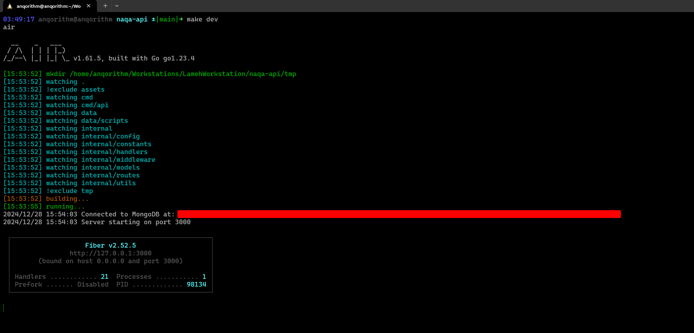
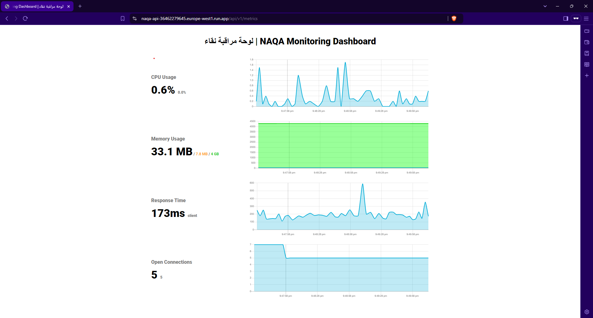
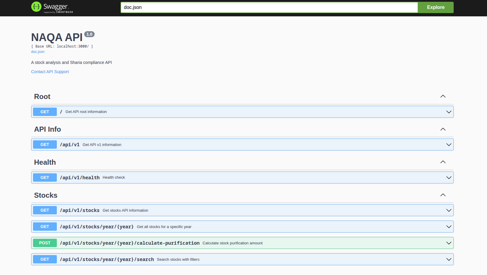
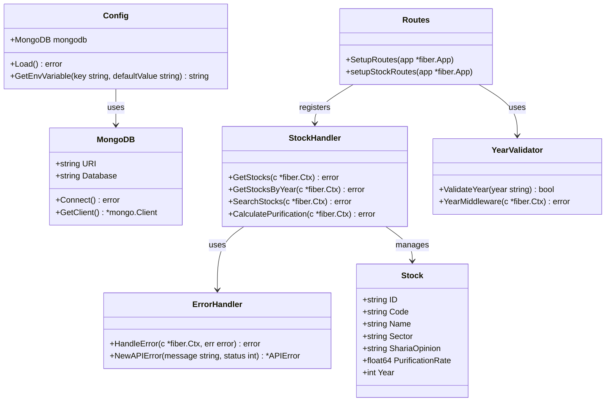
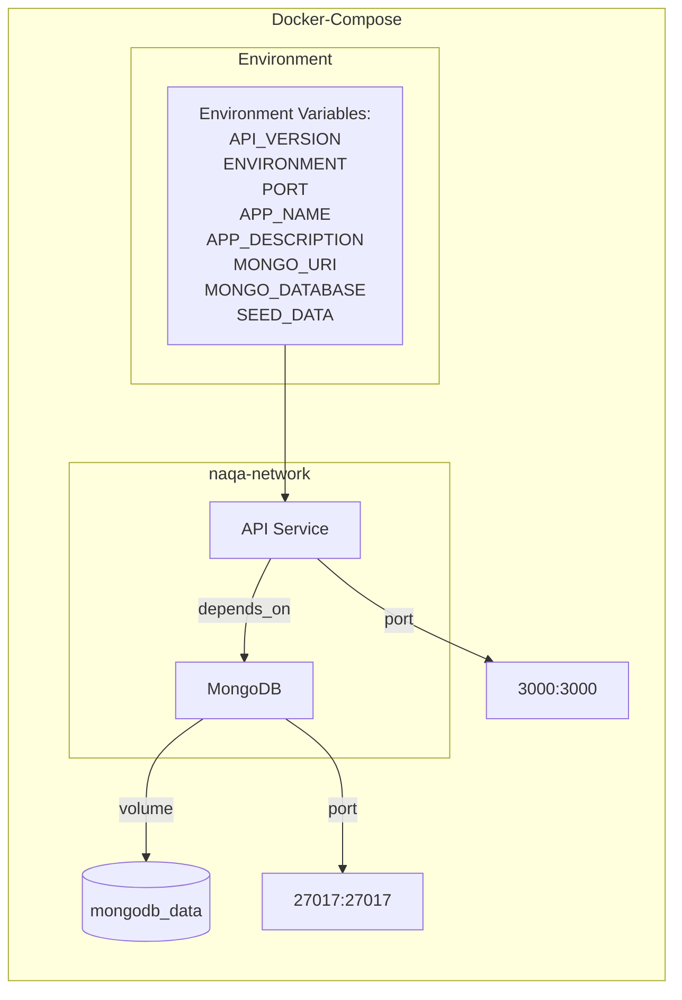
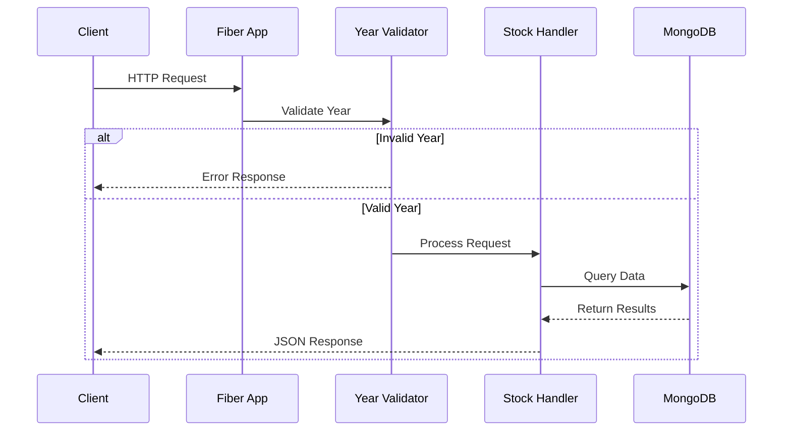

# NAQA API | نقاء API

<div align="center">
  
</div>

[](https://golang.org/)
[](https://goreportcard.com/report/github.com/anqorithm/naqa-api)
[](LICENSE)
[](https://github.com/anqorithm/naqa-api)
[](https://github.com/anqorithm/naqa-api/commits/main)
[](https://www.mongodb.com/)
[](https://gofiber.io/)


<div dir="rtl" style="text-align: center; margin: 20px 0; padding: 20px; background-color: #f8f9fa; border-radius: 5px;">

> {فَأَمَّا الزَّبَدُ فَيَذْهَبُ جُفَاءً ۖ وَأَمَّا مَا يَنفَعُ النَّاسَ فَيَمْكُثُ فِي الْأَرْضِ}
>
> <div style="font-size: 0.9em; color: #666;">سورة الرعد - آية 17</div>

</div>

<div dir="rtl">

## نظرة عامة | Overview
نقاء API هي خدمة RESTful مصممة لتوفير بيانات عن عملية تطهير الأسهم السعودية. توفر الخدمة معلومات دقيقة عن نسب التطهير للأسهم في السوق السعودي وتصنيفها الشرعي.

### المميزات الرئيسية | Key Features
- 🧮 حساب مبلغ التطهير للأسهم | Stock Purification Amount Calculator
- 🔍 البحث في الأسهم حسب القطاع والتصنيف الشرعي | Search Stocks by Sector and Shariah Classification
- 📊 معلومات محدثة عن الأسهم النقية والمختلطة | Updated Pure and Mixed Stocks Information
- 🌐 دعم كامل للغة العربية | Full Arabic Language Support
- 🔄 واجهة برمجة تطبيقات RESTful سهلة الاستخدام | Easy-to-use RESTful API

### المتطلبات | Requirements
- Go 1.23.4 أو أحدث | or higher
- Git
- MongoDB

### تثبيت المشروع | Project Setup
```bash
git clone https://github.com/anqorithm/naqa-api
cd naqa-api
go mod download
```

### المتغيرات البيئية | Environment Variables
```bash
cp .env.example .env
API_VERSION=1.0.0
ENVIRONMENT=development
PORT=3000
APP_NAME="Naqa API"
APP_DESCRIPTION="Naqa API is a RESTful service designed to provide data on the purification process of Saudi stocks."
MONGO_URI="mongodb://mongodb:27017"
MONGO_DATABASE="naqa"
SEED_DATA="false"
```

### التصنيف الشرعي | Shariah Classification
- نقية | Pure: أسهم متوافقة تماماً مع الشريعة | Fully Shariah Compliant Stocks
- مختلطة | Mixed: أسهم تحتاج إلى تطهير | Stocks Requiring Purification
- غير متوافقة | Non-Compliant: أسهم غير متوافقة مع الشريعة | Non-Shariah Compliant Stocks

### السنوات المدعومة | Supported Years
> السنوات المتوفرة | Available Years: 2015, 2016, 2017, 2018, 2019, 2020, 2021, 2022, 2023, 2024, 2025

</div>

---

## Overview
NAQA API is a RESTful service designed to provide data about the purification process of Saudi stocks. The service offers accurate information about stock purification rates in the Saudi market and their Shariah classification.

### Key Features
- 🧮 Calculate stock purification amounts
- 🔍 Search stocks by sector and Shariah classification
- 📊 Updated information about pure and mixed stocks
- 🌐 Full Arabic language support
- 🔄 Easy-to-use RESTful API

### Deployed on GCP


[Access the API on GCP](https://naqa-api-36462279645.europe-west1.run.app/)

### API Documentation

[Swagger Documentation](https://naqa-api-36462279645.europe-west1.run.app/docs/index.html) - Interactive API documentation

### Prerequisites
- Go 1.23.4 or higher
- Git
- MongoDB

## Version Information
- Version: 1.13.0
- Environment: Development
- Base API Path: `/api/v1`

## Quick Start

1. Clone the repository:
```bash
git clone https://github.com/anqorithm/naqa-api
cd naqa-api
```

2. Install dependencies:
```bash
go mod download
```

3. Set up environment variables:
```bash
cp .env.example .env
API_VERSION=1.0.0
ENVIRONMENT=development
PORT=3000
APP_NAME="Naqa API"
APP_DESCRIPTION="Naqa API is a RESTful service designed to provide data on the purification process of Saudi stocks."
MONGO_URI="mongodb://mongodb:27017"
MONGO_DATABASE="naqa"
SEED_DATA="false"
```

## Installation
1. Clone the project.
2. Install Go dependencies:
   ```
   go mod download
   ```

## Environment
Set the following environment variables or edit the .env file:
- MONGO_URI
- MONGO_DATABASE
- PORT

## Usage
1. Run the server:
   ```
   make dev
   ```
2. Access the API at:
   ```
   http://localhost:3000/api/v1
   ```



## Environment Variables

Before running the application, make sure to set up your environment variables:

```bash
# Copy the example env file
cp .env.example .env

# Fill in your environment variables in .env file:
API_VERSION      # API version
ENVIRONMENT      # development, production, etc.
PORT             # Server port
APP_NAME         # Application name
APP_DESCRIPTION  # Application description
MONGO_URI        # MongoDB connection URI
MONGO_DATABASE   # MongoDB database name
```

## Running the Application

### Local Development
```bash
go run cmd/api/main.go
```
Server will start at `http://localhost:3000`

## أداء النظام | System Performance

<div dir="rtl">

### مؤشرات الأداء
- استخدام المعالج: 0.0%
- استخدام الذاكرة: 31.1 MB
- زمن الاستجابة: 195ms
- الاتصالات المفتوحة: 7.8 MB

</div>

### Performance Metrics

#### CPU & Memory Usage


#### System Statistics
- CPU Usage: 0.0%
- Memory Usage: 31.1 MB
- Response Time: 195ms
- Open Connections: 7.8 MB



<details>
<summary>Monitoring Features</summary>

- CPU/Memory tracking
- Response time analysis
- Connection monitoring
- Error rate tracking
- Resource utilization
- Performance trends

</details>

### Docker Setup

#### Using Docker Compose (Recommended)
```bash
# Start services
docker-compose up -d

# Stop services
docker-compose down
```

#### Manual Docker Build
```bash
# Build image
docker build -t naqa-api .

# Run container
docker run -d -p 3000:3000 naqa-api
```

## API Endpoints

### Base URL
`http://localhost:3000/api/v1`

### Available Endpoints
```http
## Environment Variables
@baseUrl = http://localhost:3000  
@contentType = application/json

### Health Check
GET {{baseUrl}}/api/health  
Content-Type: {{contentType}}

### Metrics Dashboard
GET {{baseUrl}}/metrics  
Content-Type: {{contentType}}

### Root Endpoint
GET {{baseUrl}}/  
Content-Type: {{contentType}}

### Get Stocks by Year
GET {{baseUrl}}/api/v1/stocks/year/2023  
Content-Type: {{contentType}}

### Search Stocks with Parameters
GET {{baseUrl}}/api/v1/stocks/year/2023/search?name=aramco&sector=energy&sharia_opinion=نقية  
Content-Type: {{contentType}}

### Calculate Purification Amount
POST {{baseUrl}}/api/v1/stocks/calculate-purification  
Content-Type: {{contentType}}

```

### Search Examples

#### Search by Name
```http
GET {{baseUrl}}/api/v1/stocks/year/2023/search?name=%D8%A3%D8%B1%D8%A7%D9%85%D9%83%D9%88  
Content-Type: {{contentType}}
```

#### Search by Code
```http
GET {{baseUrl}}/api/v1/stocks/year/2023/search?code=2222  
Content-Type: {{contentType}}
```

#### Search by Sector
```http
GET {{baseUrl}}/api/v1/stocks/year/2023/search?sector=%D8%A7%D9%84%D8%B7%D8%A7%D9%82%D8%A9  
Content-Type: {{contentType}}
```

#### Search by Sharia Opinion
```http
GET {{baseUrl}}/api/v1/stocks/year/2023/search?sharia_opinion=%D9%86%D9%82%D9%8A%D8%A9  
Content-Type: {{contentType}}
```

#### Combined Search
```http
GET {{baseUrl}}/api/v1/stocks/year/2023/search?sector=%D8%A7%D9%84%D8%B7%D8%A7%D9%82%D8%A9&sharia_opinion=%D9%86%D9%82%D9%8A%D8%A9  
Content-Type: {{contentType}}
```

### مصدر البيانات | Data Source

<div dir="rtl">

هذه الخدمة مبنية على قوائم التطهير المنشورة للعامة من قبل فضيلة الشيخ الدكتور محمد بن سعود العصيمي (المشرف العام على موقع المقاصد). تم جمع وتنظيم البيانات من:

- [حاسبة التطهير - موقع المقاصد](https://almaqased.net/cleansing-calculator/%D9%82%D9%88%D8%A7%D8%A6%D9%85-%D8%A7%D9%84%D8%AA%D8%AD%D9%84%D9%8A%D9%84-%D8%A7%D9%84%D9%85%D8%A7%D9%84%D9%8A-%D9%84%D9%84%D8%B4%D8%B1%D9%83%D8%A7%D8%AA/)
- قوائم التحليل المالي للشركات المنشورة للعامة
- [دراسة القوائم المالية لعام 2025](https://almaqased.net/wp-content/uploads/2026/financial-statements-study-2025.pdf)
- حسابات نسب التطهير المعتمدة من قبل الشيخ د. محمد العصيمي

</div>

> **Important Note**: All purification rates and Shariah classifications are based on the publicly available lists and calculations approved by Sheikh Dr. Mohammed Al-Osaimi, the General Supervisor of Almaqased website.

### الاعتماد والإشراف | Supervision

<div dir="rtl">

تحت إشراف:  
**فضيلة الشيخ الدكتور محمد بن سعود العصيمي**  
المشرف العام على موقع المقاصد للاقتصاد الإسلامي

</div>

### Inspiration and Data Source

This API is inspired by [NaqausStocks.com](https://naquastocks.com/).

Data source: [Almaqased Cleansing Calculator](https://almaqased.net/cleansing-calculator/%D9%82%D9%88%D8%A7%D8%A6%D9%85-%D8%A7%D9%84%D8%AA%D8%AD%D9%84%D9%8A%D9%84-%D8%A7%D9%84%D9%85%D8%A7%D9%84%D9%8A-%D9%84%D9%84%D8%B4%D8%B1%D9%83%D8%A7%D8%AA/)  
المشرف العام: د. محمد بن سعود العصيمي

> **Note:** Supported Years: 2015, 2016, 2017, 2018, 2019, 2020, 2021, 2022, 2023, 2024, 2025


## Development

### Project Structure
```
.
├── api.http
├── assets
│   ├── 1.png
│   └── 2.png
├── cmd
│   └── api
│       └── main.go
├── docker-compose.yml
├── Dockerfile
├── go.mod
├── go.sum
├── internal
│   ├── config
│   │   ├── config.go
│   │   └── mongodb.go
│   ├── constants
│   │   └── constants.go
│   ├── handlers
│   │   ├── errors.go
│   │   ├── handlers.go
│   │   └── stocks.go
│   ├── middleware
│   │   ├── middleware.go
│   │   └── year_validator.go
│   ├── models
│   │   ├── error.go
│   │   └── stock.go
│   ├── routes
│   │   └── routes.go
│   ├── seeders
│   │   └── seeders.go
│   └── utils
│       └── utils.go
├── LICENSE
├── Makefile
├── README.md
└── sources
    ├── final_2015.json
    ├── final_2016.json
    ├── final_2017.json
    ├── final_2018.json
    ├── final_2019.json
    ├── final_2020.json
    ├── final_2021.json
    ├── final_2022.json
    ├── final_2023.json
    ├── final_2024.json
    └── final_2025.json
```


## حساب مبلغ تطهير الأسهم | Stock Purification Amount Calculation

<div dir="rtl">

### معادلة حساب مبلغ التطهير
يتم حساب مبلغ تطهير الأسهم باستخدام المعادلة التالية:

</div>

$$
\text{مبلغ التطهير} = \text{عدد الأسهم} \times \text{نسبة التطهير} \times \frac{\text{عدد أيام التملك في السنة}}{\text{إجمالي أيام السنة}}
$$

<div dir="rtl">

حيث:
- `عدد الأسهم`: إجمالي عدد الأسهم المملوكة
- `نسبة التطهير`: نسبة التطهير السنوية (النسبة المئوية)
- `عدد أيام التملك في السنة`: عدد الأيام التي تم فيها امتلاك الأسهم في كل سنة على حدة
- `إجمالي أيام السنة`: عدد أيام السنة (365 للسنة العادية، 366 للسنة الكبيسة)

**ملاحظة مهمة**: يأخذ النظام بعين الاعتبار السنوات الكبيسة والفترات متعددة السنوات، حيث يتم حساب كل سنة على حدة.

### أمثلة
لـ 100 سهم بنسبة تطهير 2.5% تم امتلاكها لمدة 180 يوم في السنة العادية:

</div>

$$
\text{مبلغ التطهير} = 100 \times 0.025 \times \frac{180}{365} = 1.233
$$

<div dir="rtl">

لنفس المثال في السنة الكبيسة (366 يوم):

</div>

$$
\text{مبلغ التطهير} = 100 \times 0.025 \times \frac{180}{366} = 1.230
$$


## Stock Purification Amount Calculation

The purification amount for stocks is calculated using the following accurate formula that handles leap years and multi-year periods:

$$
\text{purificationAmount} = \text{numberOfStocks} \times \text{purificationRate} \times \frac{\text{daysHeldInYear}}{\text{totalDaysInYear}}
$$

Where:
- `numberOfStocks`: Total number of stocks held
- `purificationRate`: Annual purification rate (percentage)
- `daysHeldInYear`: Number of days the stocks were held in each year separately
- `totalDaysInYear`: Total days in the year (365 for regular years, 366 for leap years)

**Important Note**: The system accounts for leap years and multi-year periods by calculating each year separately.

### Examples
For 100 stocks with 2.5% purification rate held for 180 days in a regular year:

$$
\text{purificationAmount} = 100 \times 0.025 \times \frac{180}{365} = 1.233
$$

For the same example in a leap year (366 days):

$$
\text{purificationAmount} = 100 \times 0.025 \times \frac{180}{366} = 1.230
$$


## Architecture Design & Diagrams

### Class Diagram



### Docker-Compose Diagram




### Request Flow Diagram



### Building for Production
```bash
go build -o naqa-api cmd/api/main.go
```

## المساهمة | Contributing

<div dir="rtl">

نرحب بمساهماتكم في تطوير هذا المشروع. للمساهمة:

1. انسخ المستودع (Fork)
2. أنشئ فرعاً جديداً (`git checkout -b feature/amazing-feature`)
3. أضف تعديلاتك (`git add .`)
4. ثبّت التغييرات (`git commit -m 'Add some amazing feature'`)
5. ارفع التعديلات (`git push origin feature/amazing-feature`)
6. أنشئ طلب تغيير (Pull Request)

</div>

We welcome contributions to enhance this project. To contribute:

1. Fork the repository
2. Create your feature branch (`git checkout -b feature/amazing-feature`)
3. Add your changes (`git add .`)
4. Commit your changes (`git commit -m 'Add some amazing feature'`)
5. Push to the branch (`git push origin feature/amazing-feature`)
6. Open a Pull Request

Please make sure to update tests as appropriate and follow our code of conduct.

## Contributors

- **Abdullah Alqahtani** - *Initial work* - [anqorithm](https://github.com/anqorithm)
  - Email: anqorithm@protonmail.com
- **Yasser** - [zYaseer](https://github.com/zYasser)

## License

This project is licensed under the MIT License - see the [LICENSE](LICENSE) file for details.

## Credits

### Data Source
- [Almaqased Cleansing Calculator](https://almaqased.net/)
- المشرف العام: د. محمد بن سعود العصيمي

### Inspiration
This API is inspired by [NaqausStocks.com](https://naquastocks.com/)
